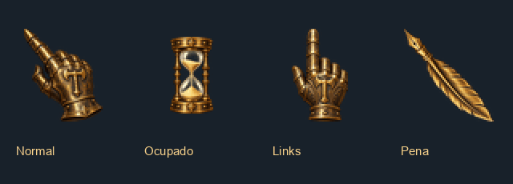
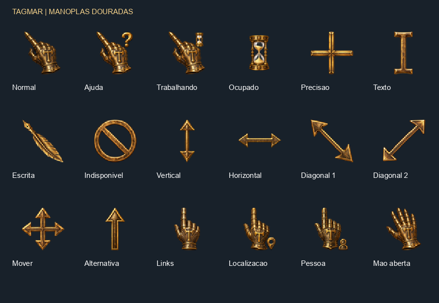

# Tagmar — Manoplas Douradas ✨

Um conjunto de cursores medievais dourados para Windows, com manoplas, símbolo de Tagmar, pena e ampulheta animada.

**[⬇️ Baixar o pacote pronto para instalar](https://github.com/piratabarba-blip/tagmar-manoplas-douradas/releases/latest/download/Tagmar_Manoplas_Douradas.zip)**



## Como instalar

1. **Baixe o ZIP** pelo link acima.
2. Clique com o botão direito no ZIP e escolha **Extrair tudo**. Não execute o instalador de dentro do ZIP.
3. Abra a pasta extraída `Tagmar_Manoplas_Douradas`.
4. Dê dois cliques em **`Instalar.cmd`**. Não precisa executar como administrador.
5. Na janela **Propriedades do Mouse**, abra a aba **Ponteiros**.
6. Na lista **Esquema**, escolha uma das opções:
   - **Tagmar - Manoplas Douradas (48px)** — opção menor.
   - **Tagmar - Manoplas Douradas (64px)** — opção maior.
7. Clique em **Aplicar** e depois em **OK**. Pronto! O conjunto inteiro é aplicado de uma vez.

Se a janela do mouse não abrir, pressione **Win + R**, digite `main.cpl` e pressione Enter. Depois abra a aba **Ponteiros**. Se ela já estava aberta durante a instalação, feche e abra novamente para atualizar a lista.

> Comece com 48px. O tamanho percebido pode variar conforme a escala da tela e as configurações de ponteiro do Windows.

## O que vem no pacote

São **17 funções por tamanho**, mais uma mão aberta opcional: **36 arquivos `.cur` e `.ani`** no total.

| Função do Windows | Desenho / efeito |
| --- | --- |
| Seleção normal | Manopla inclinada com balanço e brilho suaves |
| Seleção de ajuda | Manopla com interrogação |
| Trabalhando em segundo plano | Manopla com pequena ampulheta |
| Ocupado | Ampulheta girando 180° com pausas |
| Seleção de precisão | Mira dourada |
| Seleção de texto | I-beam dourado |
| Manuscrito | Pena com a ponta de escrita no alto à esquerda |
| Indisponível | Símbolo de proibido |
| Redimensionamento vertical e horizontal | Setas douradas |
| Dois redimensionamentos diagonais | Setas diagonais douradas |
| Mover | Quatro direções |
| Seleção alternativa | Seta para cima |
| Seleção de link | Manopla apontando para cima |
| Seleção de localização | Manopla com marcador |
| Seleção de pessoa | Manopla com pessoa |
| Extra opcional | Mão aberta animada |



### Sobre as animações

- As mãos têm um balanço discreto ao redor do ponto de clique, que permanece fixo na ponta do indicador.
- O brilho percorre o metal e a região do emblema recebe um pulso suave de luz.
- O movimento é da imagem da mão inteira, sem articulação individual dos dedos.
- A ampulheta de **Ocupado** gira com pausas. A areia faz parte da imagem original; não há simulação de areia caindo.
- Texto, mira, pena e setas ficam estáticos para facilitar a precisão.
- As animações repetem um ciclo de quatro segundos. **Não é necessário manter um programa aberto** e não há detecção de mouse parado.
- A mão aberta é um extra: o Windows não oferece uma função global de “agarrar” nessa lista. É possível escolhê-la manualmente em **Procurar**, se desejar.

## O que o instalador faz

O código do instalador está disponível em [`Instalar.ps1`](Tagmar_Manoplas_Douradas/Instalar.ps1).

Ele copia os arquivos para:

```text
%LOCALAPPDATA%\Tagmar\Cursores\ManoplasDouradas-v1
```

E cadastra os dois esquemas na sua conta, em:

```text
HKEY_CURRENT_USER\Control Panel\Cursors\Schemes
```

O instalador **não aplica o esquema automaticamente**: você escolhe e confirma em **Aplicar**. Não substitui os arquivos de cursores do Windows. O lançador usa uma opção de execução do PowerShell apenas para esse processo, sem mudar a política permanente do computador.

Depois da instalação, a pasta extraída e o ZIP podem ser removidos. Mantenha a pasta em `%LOCALAPPDATA%` enquanto estiver usando o conjunto.

## Como voltar ao cursor anterior

1. Pressione **Win + R**, digite `main.cpl` e pressione Enter.
2. Abra **Ponteiros**.
3. Selecione seu esquema anterior ou um dos esquemas padrão do Windows.
4. Clique em **Aplicar**.

## Dúvidas rápidas

**O esquema não aparece na lista?** Feche a janela do mouse, execute `Instalar.cmd` com todos os arquivos extraídos e abra novamente. Confira se o instalador mostrou alguma mensagem de erro.

**O pacote funciona dentro dos jogos?** Jogos e aplicativos que desenham seus próprios cursores podem ignorar o esquema do Windows.

**As funções localização e pessoa não aparecem?** A disponibilidade e o uso dessas funções dependem da versão do Windows e do aplicativo.

**Posso conferir o pacote sem instalar?** Sim. No PowerShell, dentro da pasta do pacote, execute:

```powershell
powershell.exe -NoProfile -ExecutionPolicy Bypass -File .\Instalar.ps1 -ValidarSomente
```

Essa opção verifica os arquivos e as 17 funções dos dois esquemas, sem instalar ou alterar o Registro.

## Verificação

Os 36 arquivos foram carregados pela API de cursores do Windows e seus pontos de clique foram conferidos. O manifesto contém os tamanhos, nomes, número de quadros e coordenadas de clique de cada arquivo.

Projeto de personalização feito por fã, sem vínculo oficial com Tagmar.
